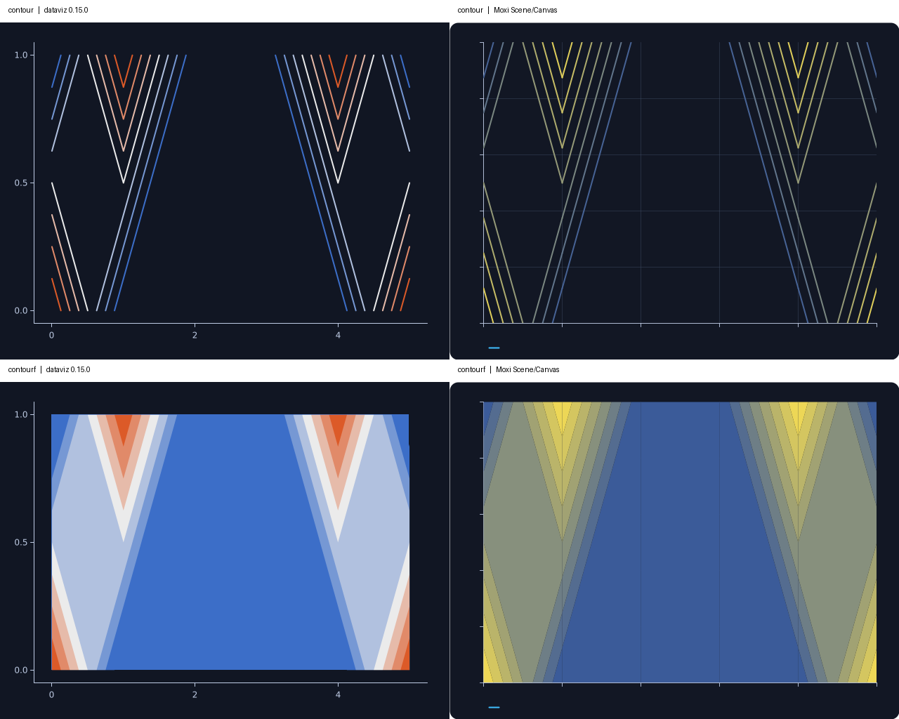

# Wave B contour connectivity

The comparison frame shows 640×480 renders from dataviz 0.15.0 and Moxi's native Scene/Canvas replay. Both plots use the same 6×2 synthetic grid. The two end cells are mirrored saddles. A column pair of zeros separates their paths at every interior threshold. At level four the corner mean equals the threshold and the high corners are disconnected. In the left cell the fixed diagonal on the published base covered 0.75 square units above this level. The pin and the repaired layout cover 0.25.



## Reproduce

Use the Moxi locked Mojo environment, a clean dataviz checkout at
`377b519e07f017d4a120b7fc3551f972a0b3fe16` with its locked environment,
and Python with NumPy, Matplotlib and Pillow. The font directory must contain
DejaVuSans.ttf. From the Moxi repository root run

```sh
PYTHONPATH=python python scripts/contour_parity.py "$UPSTREAM_ROOT" "$OUTPUT_ROOT" --saddles --font-dir "$FONT_DIR"
PYTHONPATH=python python -m pytest -q tests/python/test_wave_b.py tests/python/test_contour_scalar.py
```

The first command retains both Mojo drivers, raw logs, native and reference PNG/SVG exports, replay states, provenance, comparison frame and results in the output directory. It exercises PlotView without a window or physical input. The regression tests include an asymmetric saddle whose mean differs from the midpoint of the grid extrema.

| Scenario | Check |
| --- | --- |
| Isolines | Match each native segment at each level to one unused pinned segment, allowing reversed direction. Compare endpoints in data coordinates within 0.00002. |
| Filled bands | Compare each band's area to differences between successive genuine SVG above-level areas within 0.0001 square units. Test ownership at 501×101 interior probes. Every probe must have exactly one owner with the reference band index. |
| Interaction and recovery | Dispatch a synthetic hit and click, replace scalar data, reject nonfinite data, restore the original and exercise keyboard selection. Compare Canvas pixels after replacement, rejection and restoration. |

## Observed replay

Captured 2026-11-26 UTC on macOS 27.2.1 arm64, with the renderer sources in
`1726955` on published base `f2d6482`. Native Mojo was 1.1.0 (8189361e).
The clean upstream checkout used Mojo 1.2.0.dev2026092105 (e9569894) and
Canvas `8fcb0c83966ef872248239f9dafd6baaba06204e`. The replay used the
installed locked compilers and the same DejaVu Sans font as the shipped comparison.

All three scenarios passed. The 42 native segments matched all 42 reference segments exactly. The 47 filled polygons covered five square units. All 50,601 probes agreed and the largest absolute band-area error was 0.00000680 square units. Both charts selected fixture key 100. Replacement changed pixels, rejection retained them and restoration reproduced the original frames. Python and native glyph bounds, polygon vertices, labels and colors agreed within the harness tolerance.

The original gallery grid was also replayed through the changed native implementation. Against the original pinned run, all 55 segments matched with maximum endpoint error 0.000000151 data units. Its 71 filled polygons covered all 16 square units. The cached reference SVGs matched the shipped SVGs byte for byte. The per-band area and probe checks above apply to the saddle fixture.

The screenshot shows differences in palette, axes, tick labels, padding and native band seams. Exact-threshold constant cells retain Moxi's upper-band ownership. These fixtures do not establish universal filled-region equivalence, independent scientific acceptance, GPU rendering or controlled performance.

[Measured results](results.json)

## Radial scope

In the published 640×480 donut captures the solid wedge colors span 359×359 pixels on Canvas and 374×374 in the Python export, excluding the footer. Both have a square outer extent at this size. Category/value labels and the padding difference remain. This measures existing captures only. Independent-axis stretching recorded for chord belongs to Wave C. Other radial families and viewport sizes still need direct comparison to generalize the aspect assessment.

[Published radial captures and source record](../demo-slideshows/plot-contour-followup/radial-spot-checks.json)
