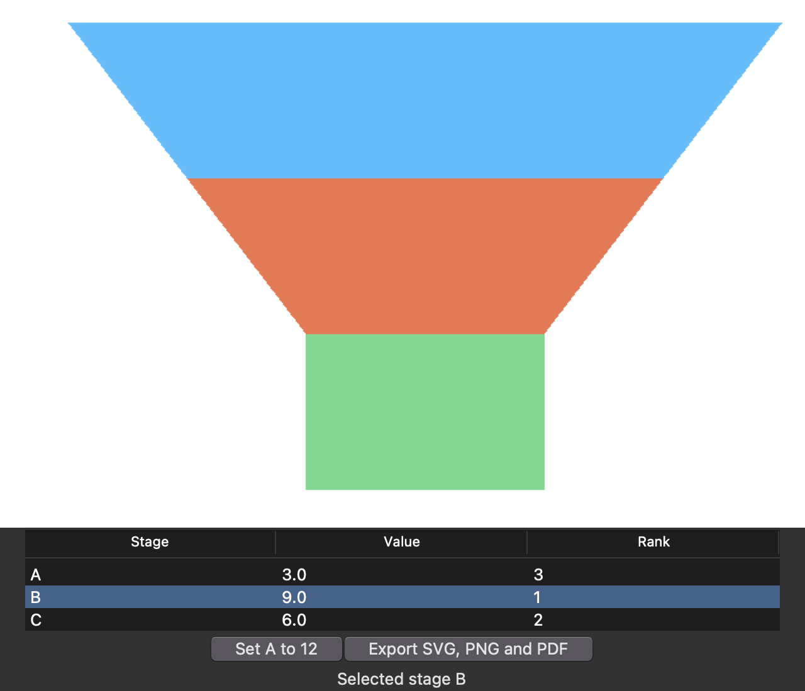

# Funnel stage inspector

Run the inspector with a Tk-enabled Python from the repository root.

```sh
PYTHONPATH=python pixi run python examples/funnel/inspector.py --output /tmp/moxi-funnel
```

Click a band to select its source row. Click **Set A to 12** to move A from the bottom to the top. The export button writes the current Moxi figure as SVG, PNG and PDF to the output directory. The native companion runs the same fixture in a Moxi PlotView and dispatches pointer and keyboard events offscreen.



## Reproduce the checks

Use a fresh output directory. The native driver writes its SVGs and CSV in its working directory. The GUI replay exports the initial fixture before changing A.

```sh
root=$PWD
out=$(mktemp -d)
(cd "$out" && pixi run --manifest-path "$root/pixi.toml" mojo run -I "$root/src" "$root/examples/funnel/main.mojo")
PYTHONPATH=python pixi run python examples/funnel/inspector.py --output "$out" --replay
python3 examples/funnel/compare.py "$out"
PYTHONPATH=python python3 scripts/plot_catalog/check.py
PYTHONPATH=python python3 -m pytest -q tests/python/test_funnel.py
```

The comparator reads the actual SVG vertices from all three renderers, maps each plot rectangle to unit coordinates and checks all 12 vertex pairs. It also checks the native source table, PDF vector paths and PNG signature.

## Recorded comparison

[Open the four-frame visual comparison](evidence/comparison.html) for the source, upstream reference, Moxi geometry, selection and update.

Captured November 25, 2026 on macOS arm64 with Mojo 1.1.0, Python 3.14 and Tk 8.6 at a 640 × 420 chart size. The checkout was based on `0124f2c` with this funnel change applied.

| Step | Expected and observed |
| --- | --- |
| Source and reference | The [upstream driver](../../scripts/plot_catalog/reference.mojo) passes A=3, B=9, C=6 to dataviz_mojo v0.8.0. Its [reference SVG](../../tests/fixtures/plot_catalog/funnel.svg) shows B → C → A, with a rectangular last band. |
| Moxi and difference | Both the [native Scene](evidence/native.svg) and [Python figure](evidence/funnel.svg) matched the centered widths and stage order. Maximum normalized vertex difference was 0.001905 for each export, within the 0.003 bound for reference pixel rounding. Moxi uses its own margins and palette. Upstream labels three swatches. The native view labels its single series, and the inspector identifies stages through its source table. |
| Selection and table | Three GUI clicks selected source indices 1, 2 and 0. The native replay returned stable keys 11, 12 and 10. The [selected native scene](evidence/selected.svg) shows the last pick and the [CSV](evidence/source.csv) retains input order. The first native accessibility row identifies stage B. |
| Update and keyboard | Changing A to 12 moved it to the top. Clicking it returned key 10. Escape reset focus, two Right presses reached B, and Enter selected key 11 in the [updated scene](evidence/updated.svg). The Tk replay checked the updated selected row, value and rank. |
| Boundaries and compatibility | The native and Python checks ranked 9007199254740993 ahead of 9007199254740992. Equal values retained source order. A zero-width stage remained a source row and had no selectable area. Negative and all-zero datasets failed validation. The unchanged row-layout catalog fixture retained its eight row hits. |

The Python GUI capture shows the app content after a dispatched click. Physical mouse, keyboard and screen-reader use and other operating systems were not exercised. Reference comparison covers normalized stage geometry. Colors, text, legend placement and whole-image perceptual differences have no parity score.

For a three-stage timing sample, the native replay times 100 PlotView constructions and Scene builds with a command count. One run took 1.04 ms total for 1,000 Scene commands. Python figure construction and SVG export took 56.3 μs per iteration (best of five batches of 100). These measure different operations on a small fixture.

```sh
PYTHONPATH=python:examples/funnel pixi run python -m timeit -n 100 -r 5 \
  -s 'from inspector import figure' 'figure([3,9,6]).to_svg()'
```

The native software renderer fills polygon bounds, which produces rectangular bands. Canvas and SVG preserve the taper.
