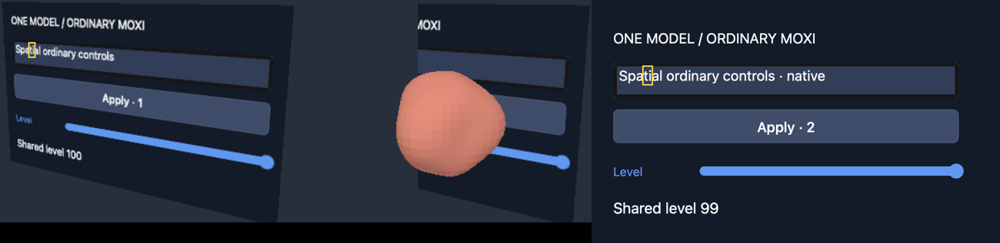

# S4 planar ordinary-component feasibility probe (D08)

Run from the repository root on macOS ARM64 with the checked-in `pixi.lock`:

```sh
pixi install --locked
bash examples/spatial-world-panel/build.sh
./dist/spatial-world-panel/panel
python3 examples/spatial-world-panel/gallery.py
bash examples/spatial-world-panel/check.sh --skip-build
```

`gallery.py` is the standalone build/replay/capture recipe. It records toolchain
versions, hashes all scoped source **before** building, and refuses to publish a
manifest if the source differs after three replay processes. Native screenshots
and generated HTML are ignored. Manifests are evidence from an uncommitted tree;
the integrating parent must regenerate them after committing.

The executable mounts `TextInputControl`, `ButtonControl` and `SliderControl` in
one ordinary `App[Controls]`. Both modes use that exact model, runtime, focus IDs
and component; there is no second canvas runtime. Click the mode title (or F6
when the canvas owns keyboard focus) to switch. Tab enters/cycles the controls;
Escape first cancels composition, then provisional drag, then leaves control
focus. Pointer drag outside the plane retains capture. Losing capture or changing
mode restores the starting slider value. Keyboard arrows are delivered only to
the focused ordinary control. Native single-line field editing remains the
existing AppKit responder path in screen mode.

## Decision: do not promote world panels

For a focused single-line field the destination canvas answers AppKit
`firstRectForCharacterRange:actualRange:` using the hidden source's current
`NSTextView` field editor. It converts the native screen rectangle into panel
points, projects its four corners and returns their bounding rectangle in the
destination window's screen coordinates. The query declines ranges that cross
the field, viewport or document clip, and conservatively declines every scene
with triangle geometry because an occluder can cover the rectangle's interior.
Changing mode clears the override and invalidates AppKit's coordinate cache.

This measures forward range geometry only. The world canvas does not proxy
the source text input session, selection or inverse character hit testing.
Use F6 for editing. World accessibility children remain suppressed because
an axis-aligned frame cannot represent oblique or partially occluded hit
regions. Screen mode retains ordinary accessibility roles and frames.

The same component in a projected **screen** editor exposes actual native text,
button and slider roles. The replay verifies screen caret containment, field
editor identity retention, selection, a named AppKit clipboard (never the user's
general clipboard), marked-text protocol calls, insertion, ordinary App clipboard
commands, Tab/Enter/arrow scope and shared model values. Synthetic calls do not
prove physical IME behavior, assistive technology usability or human acceptance.
VoiceOver stays paused. A native API that supplies coherent transformed text and
semantic geometry, followed by real IME/AT acceptance, would change the decision.
D05's production renderer decision remains OPEN.

The synthetic replay uses AppKit pointer events to focus the ordinary field,
queries insertion range `0+0` and substring `3+2`, then clips the field
and switches the same model to the screen editor. Yellow outlines in frames
03 and 05 mark the queried substring. To retain a local comparison without
regenerating the gallery, build as above and run:

```sh
mkdir -p dist/d08-evidence/after
dist/spatial-world-panel/panel --replay dist/d08-evidence/after
```

#### Native replay, November 25, 2026



Left to right: AppKit range `3+2` on the world panel, the same area after
clipping and adding a scene object, and the same substring in the screen
editor after native insertion. The replay checked the clipped range before
adding the object. On macOS 27.2.1 arm64, with a 1000×710-point destination
and 2× AppKit capture, the source field editor reported a zero-width,
19-point-high insertion rectangle at (22, 56). Its four corners enclosed
(386.33, 258.01, 0.69, 14.18) in destination points. The destination canvas
returned those bounds within 0.01 point on each edge. Range `3+2` measured
(401.16, 259.05, 5.62, 14.91) in world presentation and
(420.38, 271.04, 8.69, 19.00) through the screen field editor.
The replay verified source-editor identity, retained model state and the
screen text/button/slider accessibility roles. Separate native checks queried
retained, partially clipped and fully clipped ranges, an unfocused field,
a populated scene and a retired source owner.

### Packaged baseline, November 23, 2026

A fresh macOS arm64 replay built the public module and linked three consumers
from a directory containing only the package inputs at `3971322`. The world
caret measured (26.00, 58.00) in owner coordinates. Projection required
(388.62, 259.67). The screen editor's caret landed inside its control at
(398.09, 273.04). Contract, lifecycle, AppKit text protocol, Metal composition
and the 17-frame explorer and 14-frame assembly replays passed.
That baseline returned source-local geometry in world mode. Physical IME and
assistive-technology acceptance remain open.

## Bounded seam and policy

`moxi_spatial.WorldPanel` borrows one live `SpatialViewport`. Its configuration is
an origin and two non-collinear affine edge vectors, plus integral local dimensions
up to 1024. It uses the existing projection, unprojection, ray-plane intersection,
triangle picking and document clipping. There is no duplicated camera math.
The C boundary validates all phases and numbers; unsupported enum values,
nonfinite input and degenerate planes/rays fail. Ray distance uses the normalized
rays produced by the existing spatial core. The source and destination native
owners must differ and remain alive; source dimensions must exactly match.

World position and UVs are carried by real triangles in the existing Metal depth
pass, with perspective-correct interpolation. CPU half-space clipping interpolates
UVs on the same retained half-space as scene geometry. Near/far crossings reject
the **entire** plane, including input; behind-camera planes cannot target controls.
Viewport points and backing scale remain distinct. Pointer capture permits points
outside the rectangle/viewport on the infinite plane, but rejects clipped or
occluded points and cancels on revision/lifecycle change. Semantic geometry for
world controls is explicitly unsupported for every visibility state; no hidden
world child is exposed as an accidental native target. The screen route is an
intentional editing alternative and has ordinary native semantics.

The source-owner snapshot hook copies actual AppKit content and restores the
previous active owner on success/failure. It does not transport focus, IME or AX.
Texture storage is per renderer, separate from D07's shared document geometry;
linked cameras and geometry sharing remain intact. Draw failure must be handled
by the caller; the probe asserts failure rather than displaying an invented fallback.

## Costs and limits

One panel per view, one pointer, up to 16 views / 8 native windows / 32 composition
resources (existing limits). Local texture <=1024² RGBA, destination <=2048² RGBA.
This fixture uses a 400×240 texture (384,000 bytes) and 940×420 render target
(1,579,200 bytes); color + depth alone total 3,158,400 bytes. Each explicit render
captures AppKit, copies RGBA, uploads/replaces the texture, renders depth,
synchronously reads back and publishes another copied image. The plane contains
6 vertices, or at most 9 after clipping, at 32 bytes each. Output publication and
composition retain/copy images under the existing two-snapshot resource bound.
Temporary bitmap/color-conversion/driver allocations are additional and unmeasured.

The app rebuilds its five-control view for each rendered frame; this glue is
intentionally measured rather than hidden behind a performance claim. Its ordinary
component event/clipboard handlers adapt the existing canvas example's pattern
(about 60 lines); app layout, mode selection, replay and native capture remain
example code. Mapping and clipping live in the reusable package. No production
renderer, automatic damage scheduling, curved UI or general spatial layout is added.

Timing metadata reports three cold first-draw observations and 90 warm draws,
including component rebuild/snapshot/publication, plus the bridge's narrower timing.
Idle mappings do not submit GPU work. These small distributions are not sustained
throughput, input-to-photon, thermal, memory-pressure or performance guarantees.
Human text/IME/AT acceptance, window/compositor display, scale quality and sustained
performance remain unverified. No hardware or physical device control is used.
